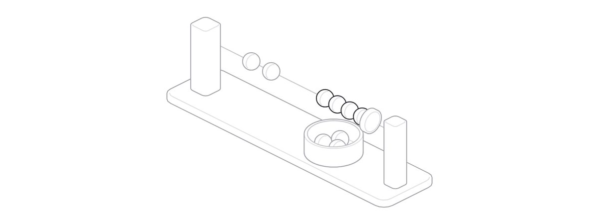

# hookspool

**Durable, coalescing intake for inbound webhooks.** hookspool sits between your reverse proxy and whatever consumes the
events, whether that is an agent gateway, a script or an HTTP endpoint. It writes every event to disk before its sender
gets a 2xx, holds it until the destination accepts it, and turns a burst of events into one wake-up.

<picture><source media="(prefers-color-scheme: dark)" srcset="docs/assets/banners/brake-dark.gif"></picture>

One Python package with no dependencies in the core, one SQLite file and two small processes. No queue server, no
database server, no LLM anywhere in it.

## The problem

<picture><source media="(prefers-color-scheme: dark)" srcset="docs/assets/banners/letterbox-dark.svg"></picture>

A webhook is a promise that the sender will tell you once. Most receivers keep it badly: they acknowledge the request and do
the work in memory, so a restart, a crash or a slow downstream loses the event, and a sender that already got its 200 will not
try again. A burst of events wakes an expensive consumer once per event. When the consumer is down, nothing holds the backlog
and nobody finds out. hookspool is the small, plain thing in front that fixes those and nothing else.

## What it guarantees

<picture><source media="(prefers-color-scheme: dark)" srcset="docs/assets/banners/ratchet-dark.svg"></picture>

- Commit before acknowledge. A request is verified and committed to SQLite before the sender sees a 2xx, or it gets a 503.
- At-least-once delivery. A batch is delivered until the destination accepts it; an outage delays work and never loses it.
- Order per key. Batches of one key go oldest first; different keys go in parallel.
- Bounded batches. A batch seals at its event count or byte size, however long its destination is down.
- Bursts become one wake-up. Events with the same key coalesce in a window and arrive together, every one, in order.
- Nothing is discarded automatically. Only `hookspool drop` discards, and bodies and secrets stay out of logs.

## How it works

<picture><source media="(prefers-color-scheme: dark)" srcset="docs/assets/banners/beads-dark.gif"></picture>

The intake checks each request, writes it to the spool and answers. The dispatcher groups events with the same key into a
batch, waits for a lull, then delivers the batch with retries and a circuit breaker per destination. A script, an HTTP
endpoint or an agent gateway receives it. The design and every failure mode are in [docs/architecture/](docs/architecture/README.md).

## Quick start

<picture><source media="(prefers-color-scheme: dark)" srcset="docs/assets/banners/spindle-dark.svg"></picture>

```sh
git clone https://github.com/jaredzimmerman/hookspool && cd hookspool
python3 -m venv .venv && . .venv/bin/activate && pip install .
export HOOKSPOOL_HOME="$PWD/demo"   # config.toml lives here (written in the full quick start)
hookspool check          # validate config.toml
hookspool migrate        # create the spool
hookspool dispatch &     # the deliverer
hookspool intake &       # listens on 127.0.0.1:8650
```

This block is an outline: it needs a `config.toml` in that directory. The [full quick start](docs/getting-started/quick-start.md) writes it, sends signed events and shows three of them
arriving as one delivery. Other first steps are in [docs/getting-started/](docs/getting-started/README.md).

## Bobbins

<picture><source media="(prefers-color-scheme: dark)" srcset="docs/assets/banners/rack-dark.svg"></picture>

A bobbin is the plugin for one outside service. It knows how that service proves a request is genuine, what to group its
events on, and sometimes how to ask it what changed. You turn one on with a few lines of config. Built in today: GitHub,
Gmail, Google Calendar, Google Drive, Plaid, Trello, Zoom and Kaneo, plus `hookspool.webhook` for any service that signs a
JSON POST. Each is named `<vendor>.<product>` (`google.gmail`, `atlassian.trello`).

[The catalogue](docs/bobbins/README.md) lists them with a line each, and `hookspool bobbin list` prints the same from the
installed copy. Setup steps and how to write a new one are in [docs/bobbins/](docs/bobbins/README.md).

## Documentation

- [Getting started](docs/getting-started/README.md): install, the quick start, your first bobbin, verifying.
- [Configuration](docs/configuration/README.md): every config key, spans, routes, tees, unwrap and bobbin instances.
- [Bobbins](docs/bobbins/README.md): the catalogue, writing one, private bobbins and hooks, review criteria.
- [Operations](docs/operations/README.md): running it, health and repair, sweeps, drills, upgrading, the CLI reference.
- [Architecture](docs/architecture/README.md): the design, how it compares with other tools, the FAQ.
- [Agents](AGENTS.md): a guide for coding agents, both for working on this repository and for operating a deployment.
- [Changelog](CHANGELOG.md): what changed.

## Contributing

Pre-1.0: the behaviour in these docs is what the test suite pins, but interfaces may change before 1.0, and the changelog says
when they do. A new bobbin is the most useful contribution; [CONTRIBUTING.md](CONTRIBUTING.md) says how.

## License

MIT. See [LICENSE](LICENSE).
