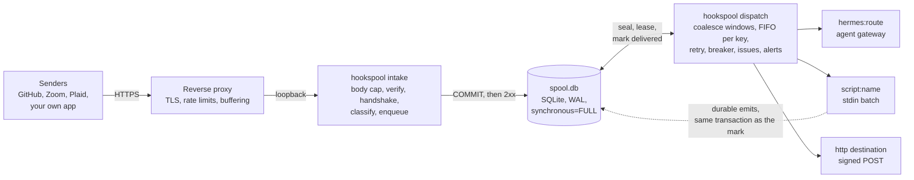

# hookspool

**Durable, coalescing intake for inbound webhooks.** hookspool sits between your reverse proxy and whatever consumes
the events: an AI agent gateway, a script, an HTTP endpoint. Every event is written to disk before its sender gets a
2xx. It waits there until its destination accepts it, and a burst of events becomes one wake-up instead of fifty.

It is one Python package (standard library only for the core), one SQLite file and two small processes. There is no
queue server, no database server and no LLM anywhere in it.

```
senders ── TLS ──> reverse proxy ──> hookspool-intake ──> spool.db <── hookspool-dispatch ──> hermes:route
                                      verify, classify,   (SQLite,      coalesce, order,      script:name
                                      commit, then 2xx     WAL, FULL)    retry, breaker        http endpoint
```

## The problem

A webhook is a promise from the sender that it will tell you once. Most receivers keep that promise badly:

- They acknowledge the request, then do the work in memory. A restart, a crash or a slow downstream loses the event, and
  the sender, which already got its 200, will not try again.
- Some senders never retry at all. GitHub does not redeliver a failed delivery on its own.
- A burst (a push that triggers twenty checks, a calendar edit that fires six notifications, a bank sync that sends a
  notice per account) wakes an expensive consumer once per event.
- When the consumer is down, nothing holds the backlog, nothing limits it, and nobody finds out.

hookspool is the small, boring thing in front that fixes those four things and nothing else.

## What it guarantees

| | |
|---|---|
| **Commit before acknowledge** | A request is verified and committed to SQLite (`synchronous=FULL`) before the sender sees a 2xx. If it cannot be kept, the answer is 503, never a 2xx. |
| **At-least-once delivery** | A batch is delivered until the destination accepts it. A busy or dead destination delays work; it never discards it. Transport failures never count against a batch, so a multi-day outage kills nothing. |
| **Order per key** | Batches of one key are delivered oldest first. Different keys go in parallel. |
| **Bounded batches** | A batch seals at its event count or byte size inside the transaction that adds the event, so it never exceeds its bounds however long its destination is down. |
| **Bursts become one wake-up** | Events with the same key coalesce in a window (quiet period, maximum wait) chosen per kind of source, and are delivered together, every event, in order. |
| **A verified request is never lost to our own bug** | If a source plugin raises after the signature checked out, the request is quarantined (kept, answered 202, an issue opened) and can be replayed after the fix. |
| **Nothing is discarded automatically** | A batch is dead only when the receiver rejects the document itself, or after many counted failures. Dead batches wait for an operator. Only `hookspool drop` discards. |
| **Secrets and bodies stay out** | Signatures are checked in constant time before any code that sees the payload runs. The one exception is a handshake that carries no signature and returns a constant (for example a Trello `HEAD`). Secrets are references to files or environment, never stored. Logs carry ids, sizes and codes, never bodies or headers. |

## What it does not do

- **Exactly-once.** Delivery is at-least-once. Receivers must tolerate a repeat; each HTTP and script delivery carries a
  stable `webhook-id` per batch so a receiver can drop one.
- **Rescue events from a sender that does not retry while hookspool is unreachable.** The spool protects what reached it.
  For senders that never retry, a periodic sweep reconciles (see [Sweeps](#operations)).
- **High availability.** One host, one SQLite file, one dispatcher. A restart delays delivery; it does not lose data. If you
  need a replicated, multi-node pipeline, use a managed queue.
- **Fan-out, transformation or a UI.** An event goes to one destination. A script destination can do anything
  with a batch and can emit new events. There is a CLI, `/healthz` and `/metrics`.
- **Sustained high volume.** It is sized for one modest host and tens to thousands of events a day. It has not been
  benchmarked for more, and SQLite takes one writer at a time.

## How it works



**Intake.** `hookspool intake` is a small HTTP server on loopback. Each request goes through the same fixed pipeline, with
no exceptions: body size cap, signature verification, the sender's handshake if it has one, the source's classification
(key, dedup id, type), route resolution, one SQLite transaction, then the response. A bad signature is a 401 with an empty
body. An oversized body is 413 and a chunked one 411, both before any plugin code runs. A duplicate is a 200 that says so.

**Spool.** One SQLite file holds events, batches, delivery attempts, destination state and issues. Events with the same
`(route, key)` join one open batch. The batch **seals** when it has been quiet long enough, has been open long enough, or is
big enough. Sealing is a property of the batch, not of its destination, so a gated destination gets a queue of bounded
batches and not one growing document.

**Dispatcher.** `hookspool dispatch` is the only process that delivers (it holds a lock, and a second one exits). It leases
a batch with a fencing token, delivers it, and records the result in a transaction the token guards, so a slow worker that
lost its lease cannot record anything. Failures back off from 15 seconds to about 5 minutes (plus a little jitter). A destination that fails three
times in a row at the transport level trips a circuit breaker: delivery to it pauses, events keep spooling, and one probe
batch at a time tests it until it recovers.

**Destinations.** `hermes:<route>` posts to a Hermes Agent gateway, `script:<name>` runs a program with the batch on stdin,
and `http` posts the batch, signed with [Standard Webhooks](https://www.standardwebhooks.com/) headers, to any HTTPS
endpoint.

The full design, with the failure-mode table and the reasoning behind every rule, is
[docs/ARCHITECTURE.md](docs/ARCHITECTURE.md).

## Quick start

You need Python 3.11 or newer and a shell. This runs everything locally with a script as the destination, so there is no
gateway to set up.

```sh
git clone https://github.com/jaredzimmerman/hookspool && cd hookspool
python3 -m venv .venv && . .venv/bin/activate
pip install .

export HOOKSPOOL_HOME="$PWD/demo"
mkdir -p "$HOOKSPOOL_HOME/secrets"
printf 'demo-secret' > "$HOOKSPOOL_HOME/secrets/demo" && chmod 600 "$HOOKSPOOL_HOME/secrets/demo"

cat > "$HOOKSPOOL_HOME/show_batch.sh" <<'EOF'
#!/bin/sh
# Receives one coalesced batch on stdin; exit 0 means delivered.
cat >> "$HOOKSPOOL_STATE_DIR/batches.jsonl"
echo >> "$HOOKSPOOL_STATE_DIR/batches.jsonl"
EOF
chmod +x "$HOOKSPOOL_HOME/show_batch.sh"

cat > "$HOOKSPOOL_HOME/config.toml" <<EOF
[alerts]
dry = true

[spans]
demo = { quiet_s = 3, max_s = 10 }          # wait for a 3 s lull, at most 10 s

[sources.demo]
module = "hookspool.sources.template"       # a source defined entirely in config
scheme = "hmac-sha256-hex"
header = "X-Signature"
prefix = "sha256="
key = "project.id"                          # events with the same project coalesce
dedup = "id"
span = "demo"
action = "script:show_batch"
secrets.secret = { file = "$HOOKSPOOL_HOME/secrets/demo" }

[destinations."script:show_batch"]
argv = ["$HOOKSPOOL_HOME/show_batch.sh"]
state_dir = "$HOOKSPOOL_HOME/out"
EOF

hookspool check          # prints "ok"
hookspool migrate        # creates the spool
hookspool dispatch &     # the deliverer
hookspool intake &       # listens on 127.0.0.1:8650
```

Send three signed events, one of them a repeat, and one with a bad signature:

```sh
send() {
  body="{\"id\":\"$1\",\"project\":{\"id\":\"p1\"},\"title\":\"$2\"}"
  sig=$(printf '%s' "$body" | openssl dgst -sha256 -hmac demo-secret -hex | sed 's/^.* //')
  curl -s -X POST http://127.0.0.1:8650/hooks/demo -H "X-Signature: sha256=$sig" -d "$body"; echo
}
send e1 first      # {"status":"queued"}
send e2 second     # {"status":"queued"}
send e1 first      # {"status":"duplicate"}
curl -s -o /dev/null -w '%{http_code}\n' -X POST http://127.0.0.1:8650/hooks/demo -H 'X-Signature: sha256=00' -d '{}'   # 401

hookspool list           # one open batch with two events
sleep 8; hookspool list  # delivered: the two events arrived together, in order
cat "$HOOKSPOOL_HOME/out/batches.jsonl"
```

Both events were committed before the first reply, joined one batch, waited for the 3-second lull, and reached the script
as a single document. `hookspool show 1 --attempts` shows the delivery, `hookspool status` the health of the whole
spool. Stop the demo with `kill %1 %2`.

To see the point of the spool, stop the dispatcher, send more events, and look at `hookspool list`: the intake still
answers, the events are on disk, and they are delivered when the dispatcher starts again.

## Configuration

One TOML file, validated by `hookspool check`. A source, a route and a destination:

```toml
[spans]
mail = { quiet_s = 30, max_s = 120 }

[sources.tickets]
module = "hookspool.sources.template"
scheme = "hmac-sha256-base64"
header = "X-Tickets-Signature"
key = "ticket.project_id"
dedup = "delivery_id"
span = "mail"
action = "hermes:tickets"
secrets.secret = { file = "/etc/hookspool/secrets/tickets" }

[[routes]]
name = "tickets-urgent"
source = "tickets"
match = { priority = "urgent" }
destination = "hermes:tickets-urgent"
quiet_s = 0                                 # urgent tickets are not delayed

[destinations.audit]
type = "http"
url = "https://audit.example.com/hooks/in"
secret = { file = "/etc/hookspool/secrets/audit" }
```

Coalescing is the one decision a source makes about itself, so it lives in config as a **span**: a quiet period and a
maximum wait. The defaults:

| span | quiet | max wait | for |
|---|---|---|---|
| `burst` | 2 min | 10 min | code and CI |
| `mail` | 30 s | 2 min | mail, boards, tickets |
| `calendar` | 45 s | 3 min | calendar edits |
| `sync` | 1 min | 5 min | bank and data syncs |
| `immediate` | 0 | 0 | meetings, security |

Window fields are inherited one at a time: route, then source, then span, then the global default. Secrets are always
references (`{ file = ... }`, `{ env_file = ..., key = ... }` or `{ env = ... }`), never values. Every key is in
[docs/CONFIGURATION.md](docs/CONFIGURATION.md); a complete file is [`deploy/config.example.toml`](deploy/config.example.toml).

## Sources and destinations

| source | how it is built | notes |
|---|---|---|
| `github` | config only ([`examples/sources/github.toml`](examples/sources/github.toml)) | HMAC-SHA256; ping acknowledged, not queued. GitHub never retries, so pair it with the redelivery sweep |
| `trello` | config only | HMAC-SHA1 over body and callback URL; answers the unsigned `HEAD` handshake |
| `kaneo` | config only | HMAC-SHA256; deduplicated by body hash |
| `zoom` | code plugin | signed timestamp; the URL-validation handshake is answered only after the signature verifies |
| `plaid` | code plugin | ES256 JWT with key fetching that cannot be abused to amplify requests (needs the `plaid` extra) |
| `gmail` | bobbin | Cloud Pub/Sub push with a token; one batch per mailbox; a processor reports scheduling requests, the assistant's mail and mailbox changes |
| `gcal` | bobbin | Google Calendar push; a processor reports conflicts, brief requests and changed events |
| `drive` | bobbin | Google Drive push (change feed); a processor reports changed, created and shared files by id and metadata, never contents |
| any other | **your own** | a config table or a short module: [docs/ADDING_A_SOURCE.md](docs/ADDING_A_SOURCE.md) |

| destination | what it does |
|---|---|
| `hermes:<route>` | posts the batch to a Hermes Agent webhook route, reading the route's secret fresh on every attempt |
| `script:<name>` | runs a program with the batch on stdin; its `{"enqueue": ...}` output lines become new events atomically with the delivery |
| `http` (a named table) | signed POST to any HTTPS endpoint |
| your own | a small class: [docs/ADDING_A_DESTINATION.md](docs/ADDING_A_DESTINATION.md) |

A `hermes` or `http` destination with `unwrap = true` sends each event on its own, with the sender's original payload as
the body, instead of the batch document, for receivers written for the sender (a Hermes route whose prompt reads
`{pull_request.title}`). It keeps the spool's guarantees: the batch counts as delivered only when every event was, a failure
retries the batch, and each event's `webhook-id` is stable so the receiver answers `duplicate` to one it already took. Pair
it with coalescing off for the route; see [Unwrap](docs/CONFIGURATION.md#unwrap-one-request-per-event).

## Operations

```sh
hookspool status                       # health, as JSON (the same document /healthz serves)
hookspool issues                       # grouped failures; ack, resolve or ignore by id
hookspool list --state dead            # batches waiting for you
hookspool show 41 --events --attempts  # what is in it, and what happened to it
hookspool exclude 41 9912 --yes        # leave out the one event a receiver chokes on
hookspool split 41 --max-events 100    # or cut a too-large batch in pieces
hookspool replay --dead                # retry them
hookspool pause hermes:github-ci       # hold a destination; events keep spooling
```

Backups use SQLite's own consistent copy (`VACUUM INTO`), plus `hookspool export` for a readable JSON-lines copy. Retention
prunes delivered batches after 7 days and never touches dead ones. Metrics are served at `/metrics` in Prometheus format.
Everything is in [docs/OPERATIONS.md](docs/OPERATIONS.md) and [docs/CLI.md](docs/CLI.md).

**Sweeps.** A webhook replaces a poll but never completely: watch channels expire, subscriptions are disabled after
failures, and some senders never retry. So each source keeps a cheap, idempotent sweep (once or twice a day), and declares
`expect_every_s`: if the sender goes quiet for longer, an issue opens. [`deploy/`](deploy/) has the systemd units, an nginx
example, a rollout order with a rollback for every step, a gateway-down drill and the GitHub redelivery sweep.

## FAQ

**Why SQLite and not Redis, Kafka or a hosted queue?** The target is one modest host handling thousands of events a day,
where the hard requirement is "do not lose it", not throughput. SQLite in WAL mode with full sync gives a durable commit with
no extra service to run, back up or secure, and the whole spool is one file you can inspect.

**Is it exactly-once?** No, and nothing that talks to a network can promise it. It is at-least-once with a stable
per-batch id (`webhook-id`) for the receivers that keep ids. Dedup inside the intake (by delivery id or body hash, within
a window) removes most repeats from the sender; receivers still need to be idempotent.

**What if hookspool is down when the sender posts?** The proxy returns 502. Whether the sender tries again is up to the
sender: Google Pub/Sub, Plaid and Zoom do, GitHub does not. That is what the sweep and `expect_every_s` are for, and the
per-source retry facts are in [`deploy/README.md`](deploy/README.md).

**What happens when the destination is down for days?** The breaker opens after three transport failures, one probe batch
tries it every 30 seconds to 10 minutes, events keep arriving and sealing in bounded batches, and one issue and one alert
are raised. When the probe succeeds the backlog drains in order, per key. Nothing is dropped and nothing is marked dead
because time passed.

**Do I need Hermes?** No. The Hermes destination exists because the project began as the intake for a Hermes Agent host. A
script or an HTTP destination needs nothing else.

**Can one event go to two places?** A route sends an event to one destination. Send it to a script that delivers it onward,
or emits further events with their own routes.

**How do I choose a coalescing window?** By what a wake-up costs. For something expensive like an agent run, wait for a lull
(`quiet_s`) and cap the wait (`max_s`). For latency-critical events use `immediate`. A burst that goes on forever still
releases at `max_s`, and a batch also seals at `max_events` or `max_bytes`.

**Does it need a reverse proxy?** Yes, for TLS, request buffering and rate limiting. The intake binds loopback only and
answers 411 to a chunked request, which the proxy buffers away. [`deploy/nginx.example.conf`](deploy/nginx.example.conf)
is a working configuration.

**How do I add a sender it does not know?** If the sender signs the body with an HMAC or sends a shared secret, it is one
TOML table and two capture files, no Python. Otherwise it is one short module. Either way a shared test kit exercises it
the same way as the built-in sources. See [docs/ADDING_A_SOURCE.md](docs/ADDING_A_SOURCE.md).

## How it compares

hookspool is deliberately narrow. The others are bigger and do more. This is from their public documentation as of October
2026; check theirs for the current picture.

| | hookspool | [Convoy](https://github.com/frain-dev/convoy) | Svix | Hookdeck | Inngest |
|---|---|---|---|---|---|
| **What it is** | an inbound spool in front of one consumer | an open-source webhook gateway for receiving and sending | a platform for sending webhooks to your customers, open-source server and hosted | a hosted service for receiving, queuing and routing inbound webhooks | an event-driven platform for durable functions, with debounce and batching |
| **Runs as** | one package, one SQLite file, two processes | a server with a database and queue | a server with a database, or hosted | hosted only | hosted, or self-hosted |
| **Main direction** | inbound | both | outbound | inbound | inbound events into functions |
| **Coalesces a burst into one delivery, keeping every event** | yes, built in, bounded in events and bytes | not a built-in feature that we know of | not applicable (outbound) | not a built-in feature that we know of | event batching keeps every event; debounce keeps the last |
| **Retries, backoff, circuit breaker** | yes, one breaker per destination, never discards | yes | yes | yes | yes |
| **Replay, dead-letter handling** | CLI: `replay`, `split`, `exclude`, `drop` | UI and API | UI and API | UI and API | UI and API |
| **Dashboard / UI** | none; CLI, `/healthz`, `/metrics` | yes | yes | yes | yes |
| **Fan-out to many endpoints** | no, one destination per route | yes | yes | yes | yes |
| **Operational weight** | lowest: two processes and a file | several components | several components, or none if hosted | none | none if hosted |
| **Choose it when** | one host, one consumer that is costly per call, and the requirement is that nothing is lost | you want a self-hosted gateway with a UI and many endpoints | you are the one sending webhooks to customers | you want a hosted inbound gateway and do not want to run anything | your consumers are functions in a workflow platform |

If you need a dashboard, many consumers per event, a hosted service, or throughput beyond a single machine, use one of the
others. hookspool's niche is the case where a small, self-hosted, inspectable spool with real coalescing is the whole job.
Its deliveries are signed with the Standard Webhooks scheme that Svix and others published, so a receiver written for that
scheme verifies them unchanged.

## Documentation

| | |
|---|---|
| [docs/ARCHITECTURE.md](docs/ARCHITECTURE.md) | the design and the contracts, including every failure mode |
| [docs/CONFIGURATION.md](docs/CONFIGURATION.md) | every config key, with defaults |
| [docs/CLI.md](docs/CLI.md) | every command and option |
| [docs/OPERATIONS.md](docs/OPERATIONS.md) | health, issues, repair, retention, backup and restore |
| [docs/ADDING_A_SOURCE.md](docs/ADDING_A_SOURCE.md) | config templates, code plugins and the conformance kit |
| [docs/ADDING_A_DESTINATION.md](docs/ADDING_A_DESTINATION.md) | scripts and destination classes |
| [docs/BOBBIN_REVIEW.md](docs/BOBBIN_REVIEW.md) | how a new or changed bobbin is checked (`hookspool bobbin check`) and when it merges |
| [deploy/README.md](deploy/README.md) | install, systemd, nginx, rollout, drill, sweeps |
| [CONTRIBUTING.md](CONTRIBUTING.md) | how to contribute, and the extension model |
| [CHANGELOG.md](CHANGELOG.md) | what changed |

## Status

Pre-1.0. The behaviour documented here is what the test suite pins, but interfaces may still change before 1.0; the
changelog says when they do. The suite is hermetic (a fake clock, temporary spools, stub servers, no network):

```sh
pip install -e '.[dev]'
python -m pytest -q
```

## License

MIT. See [LICENSE](LICENSE).
