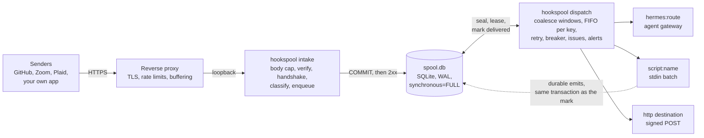

# Architecture

How hookspool works, in order of depth: this page, then [the full design](ARCHITECTURE.md), which has the data model, the
state machines, the delivery rules and every failure mode with the reasoning behind each rule.

## How it works

**Intake.** `hookspool intake` is a small HTTP server on loopback. Each request goes through the same fixed pipeline, with
no exceptions: body size cap, signature verification, the sender's handshake if it has one, the source's classification
(key, dedup id, type), route resolution, one SQLite transaction, then the response. A bad signature is a 401 with an empty
body. An oversized body is 413 and a chunked one 411, both before any plugin code runs. A duplicate is a 200 that says so.

**Spool.** One SQLite file holds events, batches, delivery attempts, destination state and issues. Events with the same
`(route, key)` join one open batch. The batch **seals** when it has been quiet long enough, has been open long enough, or is
big enough. Sealing is a property of the batch, not of its destination, so a gated destination gets a queue of bounded
batches and not one growing document.

**Dispatcher.** `hookspool dispatch` is the only process that delivers (it holds a lock, and a second one exits). It leases
a batch with a fencing token, delivers it, and records the result in a transaction the token guards, so a slow worker that
lost its lease cannot record anything. Failures back off from 15 seconds to about 5 minutes (plus a little jitter). A destination that fails three
times in a row at the transport level trips a circuit breaker: delivery to it pauses, events keep spooling, and one probe
batch at a time tests it until it recovers.

**Destinations.** `hermes:<route>` posts to a Hermes Agent gateway, `script:<name>` runs a program with the batch on stdin,
and `http` posts the batch, signed with [Standard Webhooks](https://www.standardwebhooks.com/) headers, to any HTTPS
endpoint.

## What it does not do

- **Exactly-once.** Delivery is at-least-once. Receivers must tolerate a repeat; each HTTP and script delivery carries a
  stable `webhook-id` per batch so a receiver can drop one.
- **Rescue events from a sender that does not retry while hookspool is unreachable.** The spool protects what reached it.
  For senders that never retry, a periodic sweep reconciles (see [Sweeps](../operations/sweeps.md)).
- **High availability.** One host, one SQLite file, one dispatcher. A restart delays delivery; it does not lose data. If you
  need a replicated, multi-node pipeline, use a managed queue.
- **Fan-out, transformation or a UI.** An event goes to one destination. A script destination can do anything
  with a batch and can emit new events. There is a CLI, `/healthz` and `/metrics`.
- **Sustained high volume.** It is sized for one modest host and tens to thousands of events a day. It has not been
  benchmarked for more, and SQLite takes one writer at a time.

## In this folder

| page | what is in it |
|---|---|
| [ARCHITECTURE.md](ARCHITECTURE.md) | the design and the contracts, including the failure-mode table and the bobbin API (section 14.3) |
| [How it compares](comparison.md) | hookspool next to Convoy, Svix, Hookdeck and Inngest, and when to choose each |
| [FAQ](faq.md) | why SQLite, exactly-once, what happens when a side is down, coalescing windows |
